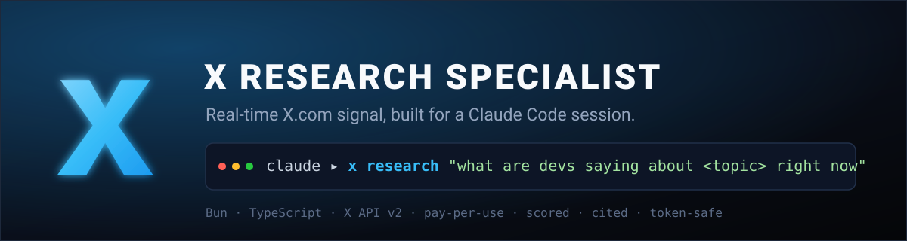

<p align="center">
  
</p>

<p align="center">
  
  
  
  
  
</p>

<h1 align="center">x — give your Claude Code session a research analyst on X</h1>

<p align="center">
  <b>Stop guessing what the world thinks. Ask it.</b><br>
  <code>x</code> turns one natural-language question into a portfolio of smart X searches, dedupes,
  <b>scores every post for signal</b>, clusters the themes, and hands your agent
  structured, cited results — not a wall of raw tweets.
</p>

---

## Why you want this

Your coding agent is brilliant but **frozen in time**. `x` is the live wire to what builders are
*actually* saying right now — the pain points, the workarounds, the "don't use that, use this," the
release-day sentiment your model's training data will never have.

It's **not** a thin Twitter client. The value is the research brain on top:

- 🎯 **Query strategy** — expands your intent into multiple angles (overview, pain, wins, debate) instead of one naive search.
- 📊 **Real signal scoring** — ranks by engagement × reach × recency × relevance, so the gold floats up.
- 🧩 **Themes & top voices** — clusters results and names who's worth listening to.
- 🔗 **Cited & structured** — JSON by default, every post carries its `id` + `url`. Your agent reasons over it; you can click through.
- 💸 **Cost-aware** — previews spend before it happens and hard-caps it.

```
claude ▸ x research "what are people hitting with agent memory in 2026" --compact --max-cost 0.50
        ↳ 27 posts · $0.14 · 10 pain / 7 wins / 2 questions · 3 themes · top voices ranked
```

---

## 🚀 Deploy it (hand this to your Claude Code session)

`x` is built to be installed **by an AI agent**. Open Claude Code (or any capable coding agent) in a
scratch directory and paste:

> Clone `https://github.com/nixfred/x.api`, read its `SKILL.md` and `README.md`, then:
> 1. `bun install`
> 2. create a launcher at `~/bin/x` that execs `bun <repo>/src/cli.ts "$@"` and sources `~/.config/x-api/env` if it exists
> 3. confirm `~/bin` is on my PATH
> 4. walk me through creating a **dev.x.com pay-per-use Bearer token** and storing it in `~/.config/x-api/env` (never print it)
> 5. verify with `x status` — I want to see `official ✅ ready`

Or do it by hand:

```bash
git clone https://github.com/nixfred/x.api && cd x.api
bun install

# launcher so `x` works from any directory
mkdir -p ~/bin
printf '#!/usr/bin/env bash\n[ -f "$HOME/.config/x-api/env" ] && { set -a; . "$HOME/.config/x-api/env"; set +a; }\nexec bun "%s/src/cli.ts" "$@"\n' "$PWD" > ~/bin/x
chmod +x ~/bin/x
# ensure ~/bin is on PATH (add to your shell rc if needed)

x help
```

---

## ⚠️ Before you start: this needs a paid X API key

X **killed the free/Basic/Pro signup tiers for new developers in Feb 2026**. A new account is
**pay-per-use only** — you buy credits and pay per call. There is no free tier. Be ready for that.

**What you need (minimum):** an app **Bearer token** on the pay-per-use package from
[dev.x.com / console.x.com](https://developer.x.com).

### Pricing (verified 2026)

| Operation | Cost |
|---|---|
| Post read (search results, others' timelines) | **$0.005** each |
| Owned read (your mentions / bookmarks) | $0.001 each |
| Post **with** a URL (writes — future) | $0.200 (a 13× penalty) |
| Cookie-provider reads (optional, see below) | **free** |

**Real-world:** a typical `x research` run reads 20–60 posts → **$0.10–$0.30**. Budget **$10** of
credit and you've got dozens of runs. Reads dedupe within a 24h UTC window, so you don't pay twice
for the same post.

**Two hard limits to know:** search only covers the **last 7 days** (full archive is Pro/Enterprise
only), and there's a 2M-reads/month cap before Enterprise.

### Store the token safely

```bash
mkdir -p ~/.config/x-api && chmod 700 ~/.config/x-api
cat > ~/.config/x-api/env <<'EOF'
X_API_BEARER_TOKEN='paste-your-token-here'
EOF
chmod 600 ~/.config/x-api/env
x status   # → official ✅ ready
```

> 🔒 The token lives in env only. `x` **never** prints it, never accepts it as a flag, and never
> sends it to the model. Keep it that way.

---

## Quickstart

```bash
x cost "rust async runtime debates"                     # preview spend — free, no creds needed
x research "real experiences with the new Claude Code hooks" --compact --max-cost 0.50
x search 'bun sqlite -is:retweet' --md                  # single query (raw X operators ok)
x timeline @simonw                                      # a user's recent posts, scored
x user @simonw                                          # profile lookup
x status                                                # which providers are live (no secrets)
```

## Command reference

| Command | What it does |
|---|---|
| `x research "<intent>"` | ⭐ Portfolio → dedupe → score → synthesize. The star. |
| `x search "<query>"` | Single search; supports natural language or raw X operators. |
| `x timeline <@handle>` | A user's recent public posts, scored. |
| `x user <@handle>` | Profile lookup. |
| `x mentions` / `x bookmarks` | Owned reads (need an OAuth2 user token). |
| `x cost "<intent>"` | Estimate spend, no network, no creds. |
| `x status` | Provider/auth health. Never prints secrets. |

**Global flags:** `--json` (default) · `--yaml` · `--compact` (token-lean) · `--md` (human) ·
`--provider official\|cookie\|auto` · `--since 7d` · `--context "<project ctx>"` ·
`--max-posts N` · `--max-cost USD` · `--queries N` · `--min-faves N` · `--dry-run`

See **[SKILL.md](./SKILL.md)** for the full contract your AI agent should read.

## How it works

```
providers/   official (X API v2 via @xdevplatform/xdk) | cookie (free, optional) → one Post shape
brain/       portfolio → dedupe → score → synthesize   (the custom value)
output/      json | yaml | compact | full | md
commands/    research · search · timeline · user · mentions · bookmarks · status · cost
```

**Optional free reads:** install [`twitter-cli`](https://github.com/public-clis/twitter-cli) and run
with `--provider cookie` for $0 reads via your logged-in session. It's ToS-grey and breaks when X
shifts its internals — opt-in only; the official API is the default.

## Develop

```bash
bun test          # unit + pipeline tests (no network, no cost)
bunx tsc --noEmit # typecheck
```

## Status & scope

`v0.1.0` — **read/research-first**, verified live end-to-end. Writes (`post`/`reply`/`quote`) are
intentionally out of scope for v1. Respects X developer terms; built for personal/research use.
